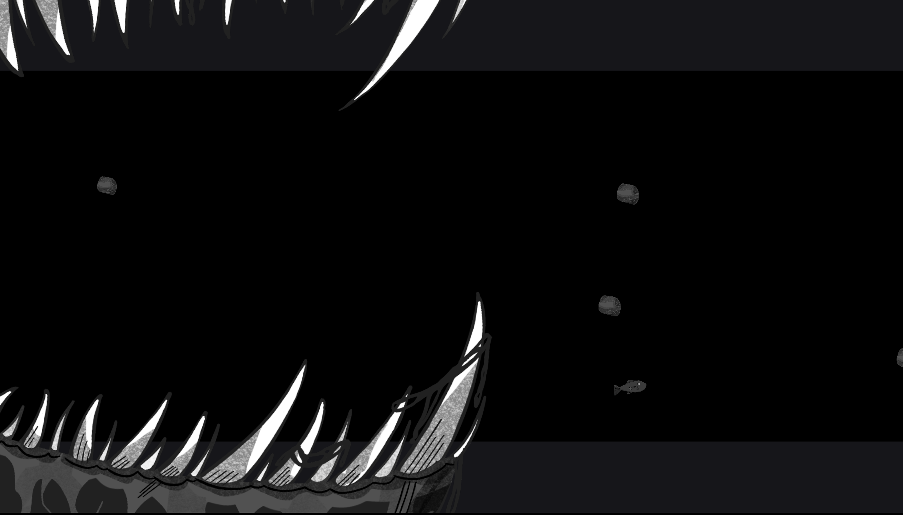

# DeepSea

A 2D underwater horror exploration game about a small fish surviving the chase of a mysterious monstrous creature and a much larger world.



Team: Haoran Xie, Yuchen Zhou, Sarah Garland.

## Build and run

You need Node.js, a C++20 compiler, and the course's `nest-libs` in a folder next to this one. [NEST.md](NEST.md) has the full setup.

```sh
node Maekfile.js
./dist/game
```

On Windows, run `dist\game.exe`. Escape quits.

For testing, `--level 2` starts Level 2 fresh, `--level 2-dev` adds fast swimming with Shift and a wider camera, and `--level 2-chase` starts after activating the machine with the same developer controls. `--level 3` previews the exit. These commands leave checkpoint saves alone.

Built on the course's base code. See [LICENSE](LICENSE).

Credits: the fish, jaw, rock, wall, cavern background, jellyfish, coral and seaweed art in `assets/` was drawn by Sarah Garland for this game.
`cavern_rock.png` is a softened version of Sarah's cavern background. The roar, rumble, chomp and rock hit sounds in `assets/sound/` were provided by Sarah Garland, and the `modified_` files are edited versions of them.
