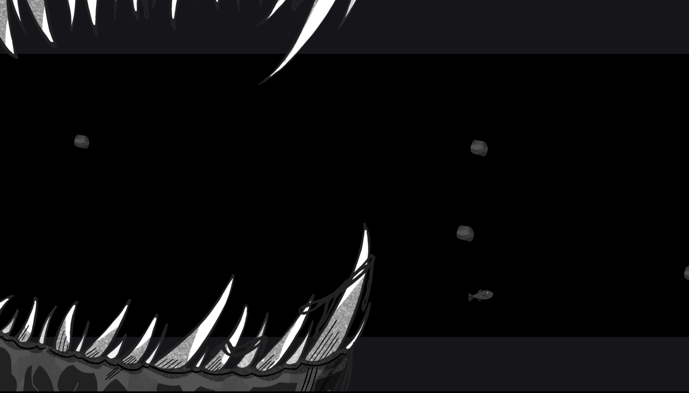

# DeepSea

A 2D underwater horror exploration game about a small fish surviving the chase of a mysterious monstrous creature and a much larger world.



Team: Haoran Xie, Yuchen Zhou, Sarah Garland.

## Build and run

You need Node.js, a C++20 compiler, and the course's `nest-libs` in a folder next to this one. [NEST.md](NEST.md) has the full setup.

```sh
node Maekfile.js
./dist/game
```

On Windows, run `dist\game.exe`. Escape quits.

Built on the course's base code. See [LICENSE](LICENSE).

Credits: the fish, jaw, rock and wall art in `assets/` was drawn by Sarah Garland for this game.
